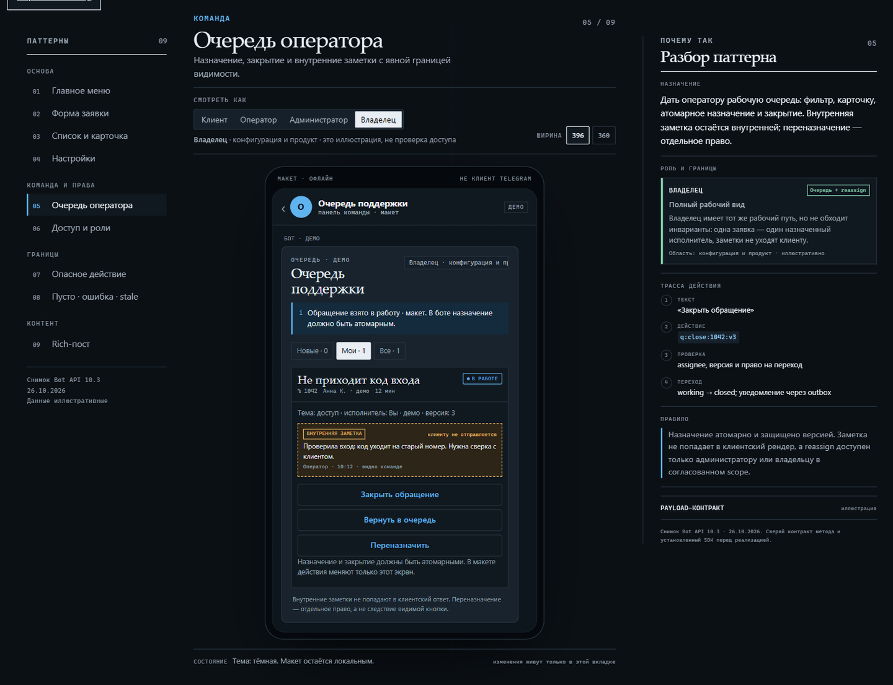

# Telegram Engineering

**Build Telegram-native bots with an AI that understands the product, not just the API.**

[](https://github.com/Ikhdev1/telegram-engineering/actions/workflows/check.yml)

An agent skill and practical toolkit for Telegram interfaces, rich messages, menus, persistent backends and in-bot administration. Start a new bot or improve an existing one without forcing a stack rewrite.

[Русский](README.ru.md) · [Quick start](#quick-start) · [AI instructions](SKILL.md) · [Interface gallery](references/gallery.md) · [Recipes](references/recipes.md) · [Verification](docs/verification.md) · [Contributing](CONTRIBUTING.md)

## Quick start

```bash
git clone https://github.com/Ikhdev1/telegram-engineering.git
cd telegram-engineering
python -m pip install -r requirements-dev.txt -r examples/support-bot/requirements.txt
python scripts/check_skill.py --json
```

Try the complete bot **without a token or a Telegram account**:

```bash
cd examples/support-bot
python -m support_bot --offline-smoke
```

For AI-assisted work, install the skill below and ask:

> Use telegram-engineering. Build a booking bot with a clear menu and in-bot administration. Ask the important product questions first, preserve my stack, and verify the result locally.

The default language of the skill and demo bot is Russian. This README is available in [Russian](README.ru.md) as well. The toolkit requires Python 3.12+; its guidance also applies to other existing stacks.

## Choose your starting point

| Goal | Start here |
|---|---|
| Let an AI design and implement a bot | [Install the skill](#install-the-skill) → [SKILL.md](SKILL.md) |
| Inspect a complete working implementation | [Support bot](examples/support-bot/README.md) |
| Catch payload and button errors locally | [Validator](references/payload-validator.md) |
| Choose a clear screen layout | [Interactive gallery](references/gallery.md) |
| Build booking, shop, club or publishing logic | [Domain recipes](references/recipes.md) |

## Interface patterns



*A screenshot of the included offline gallery, not the Telegram client. Nine interactive patterns explain the layout, actions, role boundaries and transitions. [Open it locally](#browse-the-gallery).* 

## Why this exists

- **Telegram-native UX:** ordinary and rich messages, contextual buttons, Back/Cancel, private group responses and meaningful failure states.
- **Real backend rules:** ownership, role revocation, transactional mutations, delivery replay and concurrent transitions.
- **Executable references:** a runnable bot, a bounded preflight validator and application-level evaluation cases — not only prompt advice.
- **Honest verification:** offline dispatcher/DB checks and illustrative browser proofs are kept separate from live Telegram delivery and rendering.

## Included resources

- A concise `SKILL.md` routing the agent to task-specific references.
- Guides for ordinary/rich messages, navigation, persistent state, roles, admin workflows, channels, groups and deployment.
- A runnable [support bot example](examples/support-bot/README.md), with real SQLite persistence, roles and administration.
- A bounded, offline [payload validator](references/payload-validator.md), plus request fixtures.
- A self-contained [interactive interface gallery](assets/gallery/index.html). These are illustrative mockups, **not a Telegram client or proof of Telegram rendering**.
- Five domain recipes: booking, support, commerce, membership and publishing.
- Behavior tests, application-evaluation cases, trigger-selection queries and a token-free CI workflow in the source distribution.

## Install the skill

Place the complete `telegram-engineering` directory in your agent's configured skills directory. The standard omp location is `~/.omp/agent/skills/`; other agents have their own documented locations. The package does not modify agent settings, hooks or permissions.

Build the `.skill` archive below for a clean installation. It is a ZIP containing the top-level `telegram-engineering` directory. Extract only a trusted locally built archive into your skills root. If an older version exists, back it up separately before replacing it; do not merge versions or overwrite other skills. Start a new session when the host caches its skill list.

Example prompt:

> Use telegram-engineering. Build a service-booking bot with Telegram menus and in-bot administration. Ask only material questions first; I will configure credentials locally.

For an existing project:

> Use telegram-engineering to fix object authorization and repeated callback handling. Keep this project's current stack.

## Local verification

Requires Python **3.12+**. Run these commands from the package root using the project's interpreter/virtual environment, not an unrelated global Python:

```bash
python -m pip install -r requirements-dev.txt -r examples/support-bot/requirements.txt
python scripts/check_skill.py --json
python -m unittest discover -s tests -v
```

The complete root `tests/`, `evals/` and CI are in the source archive/checkout. The compact installed `.skill` omits root tests/evals; use its package checker, validator and included example smoke, or use the source package for every verification command above.

From `examples/support-bot`:

```bash
python -m unittest discover -s tests -v
python -m support_bot --help
python -m support_bot --offline-smoke
```

The smoke invokes the **actual aiogram dispatcher and a real temporary SQLite database**. Only the Telegram transport uses an explicitly enabled no-network session. It does not prove live Telegram acceptance or delivery. Normal operation uses real Bot API credentials configured locally; see the example README for exact startup and operating limits.

## Validate a request

```bash
python scripts/telegram_payload.py --help
python scripts/telegram_payload.py --method sendMessage --file request.json --json
```

`request.json` contains the raw API payload. Exit codes: `0` no locally detected errors, `1` invalid payload, `2` invocation/I/O/JSON failure. See [supported methods and limitations](references/payload-validator.md). This is not an authoritative server-side rich-text parser, rights checker or SDK compatibility guarantee. It never sends a request.

## Browse the gallery

Open `assets/gallery/index.html` directly, or serve it locally:

```bash
python -m http.server 8765 --bind 127.0.0.1 --directory assets/gallery
```

Visit `http://127.0.0.1:8765/`. Choose another port if occupied; do not stop unrelated services. Client-side role examples illustrate UX and are not security enforcement.

## Build distributions

Run from a complete source checkout named `telegram-engineering` (rename a downloaded `telegram-engineering-main` directory first). `--kind source` refuses a compact installed skill without root tests/evals/CI. Choose an output subdirectory such as `dist`, not the source root or its ancestor. Selected files are scanned for likely Telegram tokens/private keys; this bounded guard is not a general secret scanner.

```bash
python scripts/package_skill.py --kind skill --output dist
python scripts/package_skill.py --kind source --output dist
python scripts/verify_archives.py dist
```

The `.skill` archive includes instructions, references, tools, gallery and the runnable example. The source ZIP also includes tests, evals and CI. Local project state, `.env`, databases, sessions, caches, `.git` and previous distributions are excluded. Builds are deterministic for unchanged input files and print SHA256; nothing is uploaded.

Before public release, choose a license and confirm rights to all included material. No MIT/Apache redistribution grant is claimed until a license is selected. Never commit credentials or working databases.

## Scope and evidence

The documented API snapshot is **Bot API 10.3 / aiogram 3.31.0**, not a perpetual latest-version promise. Check current official contracts and the project's actual SDK before using new fields. The SQLite example is for one polling process, not a distributed deployment.

Offline checks do not verify iOS/Android/Desktop rendering, live ephemeral delivery, payment providers or production infrastructure. This skill does not authorize account access, unsolicited broadcasts or paid features. Keep tokens, OTPs, 2FA passwords and session strings out of AI conversations and logs.
